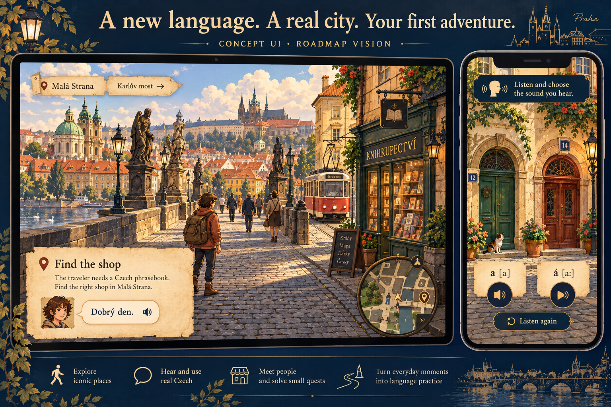
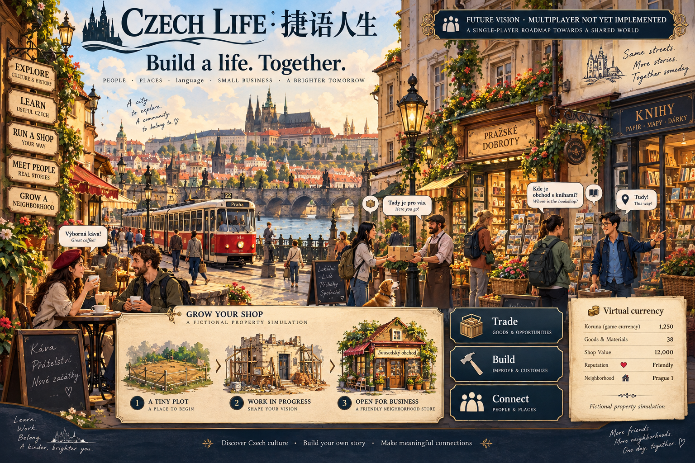

<div align="center">


# Czech Life · 捷语人生

### Learn Czech. Explore Prague. Build a life.

An open-source language adventure for people who have never spoken Czech — and want to feel at home in a real city.

**[中文](README.zh-CN.md) · [Play the prototype](#play-the-prototype) · [Roadmap](docs/ROADMAP.md) · [Contribute](CONTRIBUTING.md) · [Report a bug](https://github.com/lz850522055-bot/czech-life/issues/new/choose)**


</div>

## A language you can live in

Imagine arriving in Prague without a single Czech word. You hear two sounds, open the right door, meet a shopkeeper, ask for directions, ride across town and gradually make a place for yourself. The streets become familiar. The language starts to mean something.

That is the world we want to build: **a playable bridge between learning a language and belonging in a place**. Prague comes first; a wider Czech world is a future direction.

| Learn | Explore | Live | Build | Connect |
| --- | --- | --- | --- | --- |
| Start with sounds; learn patterns through actions and consequences. | Follow real-geography-backed roads, districts and landmarks. | Discover local culture through everyday stories. | Run fictional shops, trade and improve a neighborhood. | Eventually share the world with other players. |

**This is an early, single-player prototype seeking contributors.** Fine-art coverage is limited to two authored outdoor chunks. Map movement can stutter. The C2 curriculum is a content structure, not a completed or independently validated proficiency course. Multiplayer is not implemented. Promotional illustrations show the intended art direction, not finished gameplay.

## See the direction



*Concept UI · roadmap vision. Current UI is primarily Chinese with Czech learning content; English localization is open work.*



*Future vision · multiplayer not implemented. Property, investment and currency are fictional game systems.*

For actual prototype captures and reproducible checks, see [current state](docs/CURRENT_STATE.md). All concept images are labeled; no concept render is presented as a performance demonstration.

## What is here today?

| Area | Present in this release | Next work |
| --- | --- | --- |
| Beginner adventure | Sound gates, first-district story, NPC dialogue and saved tasks | Better onboarding and playtesting |
| Learning | Missions, grammar patterns, review, audio and a graded lesson structure through C2 | Native Czech review and richer progression |
| Prague world | Real-geography data, streamed 2D assets, two detailed outdoor chunks | Frame pacing, touch controls, more streets and interiors |
| Economy | Initial virtual shop/ledger/courtyard loop | Deeper trade, property and neighborhood design |
| Persistence | Local SQLite account and saved progress | Cross-device testing and recovery UX |
| Multiplayer | Not implemented | Design after the single-player loop works well |

See [roadmap](docs/ROADMAP.md), [known limitations](docs/CURRENT_STATE.md) and [architecture](docs/ARCHITECTURE.md).

## Play the prototype

Requires **Node.js 24+**, Git and `tar` on Windows, macOS or Linux. The application has no npm runtime dependencies. There is no hosted public demo yet.

```sh
git clone https://github.com/lz850522055-bot/czech-life.git
cd czech-life
npm run assets:fetch
npm start
```

Assets are approximately **1.01 GB compressed / 1.13 GB extracted**, fetched once from the versioned GitHub Release and checked against SHA-256. No paid API or map key is needed for the bundled prototype. Raw geography is a separate optional archive for data contributors.

1. Open the local address printed in the terminal (default `http://127.0.0.1:8766/`).
2. Use the **first-run token printed in your own terminal** to create your account. There is no shared default password.
3. Open `http://127.0.0.1:8766/game/?district=small-town` for the first district.
4. Follow the visible task controls. Audio playback needs a click/tap.

[Setup, mobile access and troubleshooting](docs/GETTING_STARTED.md). Learner records/recordings are private and excluded from this repository.

## Help make the first neighborhood great

We would rather ship **one good, playable neighborhood** than claim an unfinished country is complete.

- **Game/rendering developers:** profile camera panning, texture uploads, chunk loading and mobile frame pacing.
- **Czech speakers and teachers:** review phonetics, natural dialogue and beginner progression.
- **Game designers/writers:** turn grammar into choices, quests and consequences.
- **2D artists:** extend the detailed Prague art direction with readable scenes.
- **Prague locals/data contributors:** improve place accuracy, bilingual labels and provenance.
- **Web contributors:** English localization, accessibility, progress recovery and tests.

Start with [help wanted](https://github.com/lz850522055-bot/czech-life/labels/help%20wanted) or [good first issues](https://github.com/lz850522055-bot/czech-life/labels/good%20first%20issue). Read [CONTRIBUTING.md](CONTRIBUTING.md), then open a focused PR with verification. Maintainers review before merging. Bug reports are welcome without code.

## Open by design

- **Code/original contributions:** [MIT](LICENSE).
- **Third-party recordings, maps and vendor code:** their own licenses; see [THIRD_PARTY_NOTICES.md](THIRD_PARTY_NOTICES.md). MIT does not relicense these assets.
- **AI assistance:** initial code/content and promotional art were produced with AI assistance. Native-speaker and human gameplay review are open contribution areas. [Visual provenance](docs/media/README.md).
- **History:** public Git history starts with this baseline. Git records committed changes, not every keystroke. Private backups and learner records are not published.

Prague's **Historic Centre** is a UNESCO World Heritage property ([official listing](https://whc.unesco.org/en/list/616/)). This is an independent game, not an official city or language-certification product.
